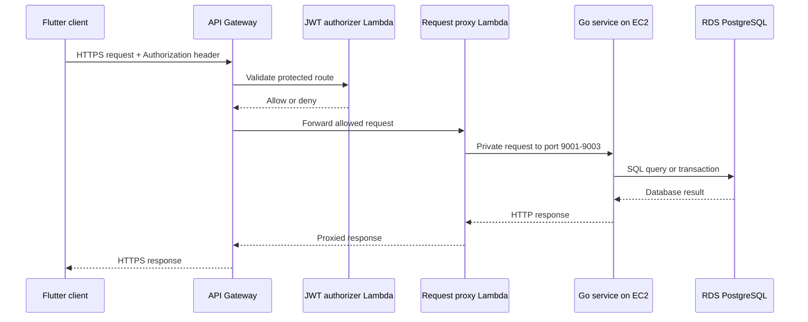
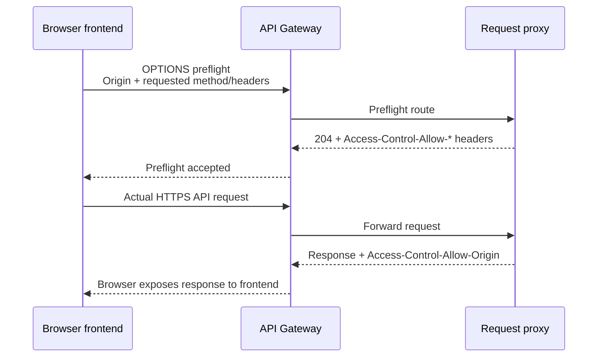
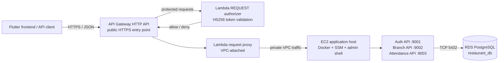
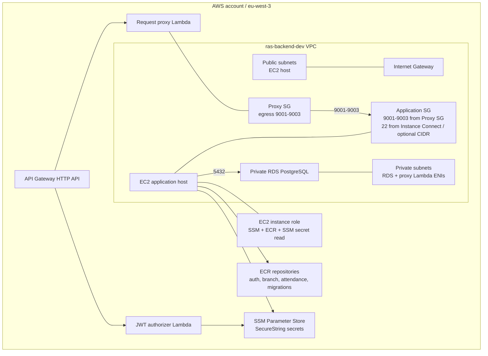
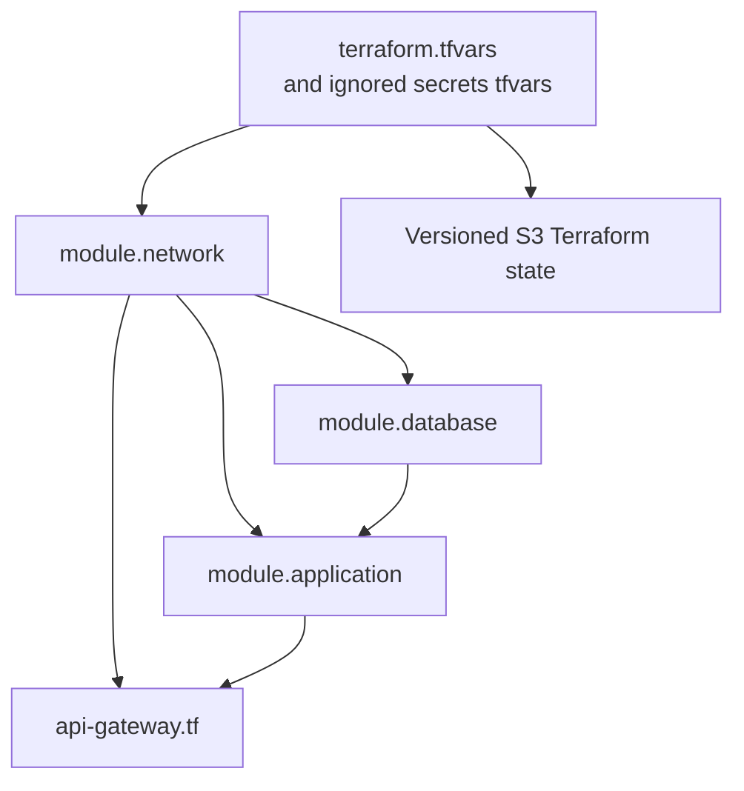
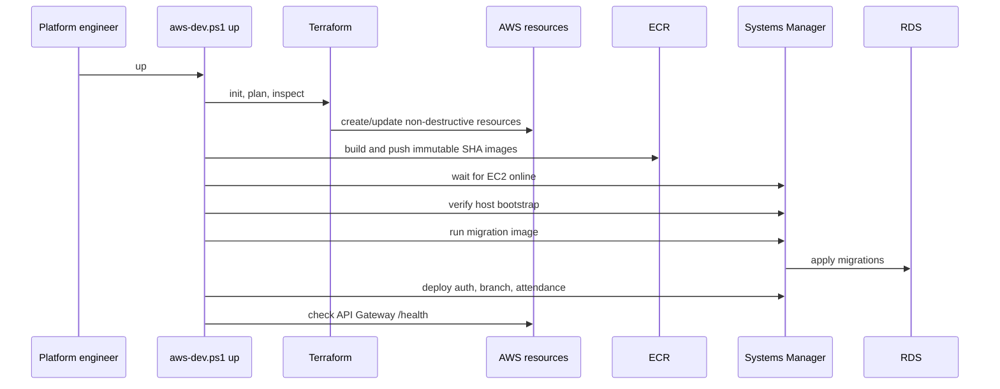

# RAS Backend Architecture and Deployment Guide

## 1. Purpose

This document explains the RAS Backend development platform as it exists in
the repository. It is written so that another engineer or ChatGPT can:

- understand the cloud topology and trust boundaries;
- explain how Terraform creates and connects the resources;
- understand what `scripts/aws-dev.ps1` does for `up`, `shell-down`, and `down`;
- create accurate architecture diagrams without inventing components;
- operate the private PostgreSQL database through the temporary EC2 shell;
- preserve RDS data when replacing only the shell host.

The deployment region is `eu-west-3`. Names, IDs, endpoints, credentials, and
tokens are environment-specific and must never be embedded in diagrams or
committed documentation.

## 1.1 Manual Terraform runbook

This section is for running Terraform directly from Windows PowerShell without
`scripts/aws-dev.ps1`. It creates and destroys AWS infrastructure, but it does
not build or push Docker images and it does not deploy containers to EC2.
Use the lifecycle script when you want the complete build-and-deploy workflow.

### Prepare once

Open PowerShell at the repository root:

```powershell
Set-Location C:\Users\myfin\OneDrive\Desktop\RAS-backend
```

Confirm the AWS identity and region:

```powershell
aws sts get-caller-identity --profile terraform
aws configure get region --profile terraform
```

Create the ignored variable file if it does not exist:

```powershell
Copy-Item infra\terraform\dev\terraform.tfvars.example infra\terraform\dev\terraform.tfvars
```

Fill in the real development-only values in
`infra\terraform\dev\terraform.tfvars` and one ignored secrets file, such as
`.tools\terraform\ras-secrets.tfvars`. Never commit either file.

Initialize Terraform with the remote state bucket:

```powershell
terraform -chdir=infra/terraform/dev init `
  -backend-config="bucket=ras-backend-tfstate-109573999710-eu-west-3" `
  -backend-config="region=eu-west-3" `
  -backend-config="profile=terraform"
```

If Terraform is stored in the repository tools directory, replace
`terraform` with:

```powershell
.\.tools\terraform\terraform.exe
```

### Build infrastructure manually

Format and validate first:

```powershell
terraform -chdir=infra/terraform/dev fmt -recursive
terraform -chdir=infra/terraform/dev validate
```

Create a saved plan. The second var-file must contain the sensitive values:

```powershell
terraform -chdir=infra/terraform/dev plan `
  -var-file=terraform.tfvars `
  -var-file=..\..\..\.tools\terraform\ras-secrets.tfvars `
  -out=..\..\..\.tools\terraform\manual-up.tfplan
```

Review the plan. For a normal build, it should create or update the VPC,
subnets, security groups, RDS, EC2, ECR, Lambda, API Gateway, SSM parameters,
and IAM resources. It must not unexpectedly destroy or replace resources.

Apply exactly the reviewed plan:

```powershell
terraform -chdir=infra/terraform/dev apply `
  ..\..\..\.tools\terraform\manual-up.tfplan
```

Expected result: Terraform prints `Apply complete!`, followed by resource
counts. The EC2 host may still need several minutes for cloud-init, Docker,
SSM Agent, and the database shell helper. Infrastructure creation alone does
not build service images, run migrations, or start API containers.

### Destroy only the temporary EC2 shell

This preserves RDS, all database rows, ECR, API Gateway, and the network:

```powershell
terraform -chdir=infra/terraform/dev plan -destroy `
  -var-file=terraform.tfvars `
  -var-file=..\..\..\.tools\terraform\ras-secrets.tfvars `
  -var=protect_database=true `
  -target=module.application `
  -out=..\..\..\.tools\terraform\manual-shell-down.tfplan

terraform -chdir=infra/terraform/dev apply `
  ..\..\..\.tools\terraform\manual-shell-down.tfplan
```

Expected result: only resources owned by `module.application` are planned for
deletion. Afterward, run the normal plan/apply again to recreate the shell.
Targeted plans are intentionally exceptional; review the target output before
applying.

### Destroy the complete application stack

This permanently deletes the development RDS database and its data. The
versioned Terraform state bucket is not part of this stack and remains:

```powershell
terraform -chdir=infra/terraform/dev plan -destroy `
  -var-file=terraform.tfvars `
  -var-file=..\..\..\.tools\terraform\ras-secrets.tfvars `
  -var=protect_database=false `
  -out=..\..\..\.tools\terraform\manual-down.tfplan
```

Review every deletion. The plan must explicitly include RDS and must not
include the separately managed state bucket. Apply only after confirming the
data-loss impact:

```powershell
terraform -chdir=infra/terraform/dev apply `
  ..\..\..\.tools\terraform\manual-down.tfplan
```

Expected result: Terraform prints `Apply complete!` and removes the application
resources. RDS data cannot be recovered from this development configuration
because automated backups and final snapshots are disabled.

### After manual infrastructure creation

To build and deploy services manually, first authenticate Docker to ECR, build
the four images with a commit-SHA tag, and push them. Then use SSM Run Command
or Session Manager to run:

```bash
sudo /usr/local/bin/ras-backend-deploy.sh migrate COMMIT_SHA
sudo /usr/local/bin/ras-backend-deploy.sh auth-api COMMIT_SHA
sudo /usr/local/bin/ras-backend-deploy.sh branch-api COMMIT_SHA
sudo /usr/local/bin/ras-backend-deploy.sh attendance-api COMMIT_SHA
```

These commands require the exact image tag and an SSM-online EC2 instance.
They are separate from Terraform because Terraform manages infrastructure,
while the deployment helper manages application images and containers.

## 2. System context

The mobile/web frontend calls one public API Gateway URL. API Gateway sends
requests to Lambda functions. The request-proxy Lambda enters the VPC and
forwards traffic to Go services running as Docker containers on one EC2 host.
Those services connect to private PostgreSQL on RDS.

## 2. Why Lambda and CORS are used

### Why Lambda functions were introduced

Lambda is used here as a small, managed integration layer at the public edge.
It lets API Gateway invoke code without requiring another always-running public
server, load balancer, or NAT gateway.

This project has two Lambda functions with different responsibilities:

1. **JWT authorizer Lambda** (`ras-backend-dev-jwt-authorizer`)
   - Receives the `Authorization` header from protected API Gateway routes.
   - Reads the JWT signing secret from SSM Parameter Store.
   - Validates the token and returns an allow/deny decision.
   - Does not query PostgreSQL and does not implement business features.

2. **Request proxy Lambda** (`ras-backend-dev-request-proxy`)
   - Receives the API Gateway request after authorization.
   - Runs inside the VPC.
   - Forwards the request to the EC2 private IP and the correct Docker service
     port (`9001` auth, `9002` branch, or `9003` attendance).
   - Returns the backend response to API Gateway.

The Go services remain responsible for authentication business logic, users,
branches, employees, attendance, overtime, migrations, and database access.
Lambda is not replacing those services; it connects the public managed API
edge to the private application network.



### Why not expose EC2 directly?

Keeping EC2 private application ports behind API Gateway and Lambda provides:

- one public HTTPS entry point;
- centralized authentication before protected requests reach EC2;
- no public access to ports `9001`, `9002`, or `9003`;
- security-group enforcement between the proxy Lambda and EC2;
- the ability to replace the EC2 host without changing the public API URL.

This is a development-oriented architecture. Lambda adds an extra network
hop and can introduce cold-start or VPC networking latency. A production
architecture might use a load balancer, container service, or a different API
integration after evaluating scale, availability, cost, and operational needs.

### What CORS means

CORS means **Cross-Origin Resource Sharing**. Browsers enforce the same-origin
policy: JavaScript running at one origin cannot freely call an API at another
origin unless the API explicitly allows it.

An origin is the combination of scheme, host, and port. For example:

```text
http://localhost:5173
http://127.0.0.1:5173
https://example.com
```

These are different origins even when they use the same machine or application.

The Flutter native mobile app does not normally need browser CORS. The browser
development build does. Without CORS, the browser may block login or API calls
before the backend receives them. A browser also sends an `OPTIONS` preflight
request before some cross-origin requests, especially requests containing
`Authorization` or non-simple methods.

In this project, CORS is configured in
[`infra/terraform/dev/api-gateway.tf`](../infra/terraform/dev/api-gateway.tf):

- allowed origins come from `api_cors_allowed_origins`;
- allowed methods include `GET`, `POST`, `PUT`, `PATCH`, `DELETE`, and
  `OPTIONS`;
- allowed headers include `authorization`, `content-type`, and `x-request-id`;
- API Gateway exposes `x-request-id`;
- preflight routes are explicitly available for public authentication routes.

The request proxy also returns the required CORS headers for `OPTIONS` and
normal responses. Both layers matter: API Gateway must accept the browser
request, and the final response must contain the browser-readable CORS headers.



### CORS is not authentication

CORS is a browser permission mechanism, not a security boundary for the API.
It does not validate users, protect PostgreSQL, or replace JWT authorization.
Non-browser clients can ignore CORS and still send HTTP requests, so protected
routes must continue to enforce the JWT authorizer and backend authorization.

The correct separation is:

| Concern | Mechanism |
|---|---|
| Browser may read the response | CORS |
| Request has a valid access token | JWT authorizer Lambda |
| User may perform the operation | Go service role/authorization checks |
| Service may reach PostgreSQL | VPC routing and security groups |
| Database user may execute SQL | PostgreSQL roles and grants |



### Important boundaries

| Boundary | Allowed path | Not allowed |
|---|---|---|
| Public internet to API | HTTPS to API Gateway | Direct access to EC2 service ports |
| API Gateway to Lambda | AWS-managed invocation | Direct API Gateway-to-RDS access |
| Proxy Lambda to EC2 | Ports 9001-9003 through security groups | Public ingress to application ports |
| EC2 to RDS | Port 5432 through the application security group | Public RDS access |
| Operator to EC2 | SSM Session Manager or regional EC2 Instance Connect | Shared database password in chat |

## 3. AWS resource architecture

Terraform creates the following layers:

1. **Network**: VPC, two public subnets, two private subnets, internet gateway,
   route table, application security group, and proxy security group.
2. **Database**: private RDS PostgreSQL, private subnet group, database security
   group, and encrypted SSM master-password parameter.
3. **Application host**: one EC2 instance, instance profile, IAM policies,
   Docker, SSM Agent, AWS CLI, PostgreSQL client, deployment helper, and
   `ras-db-shell.sh`.
4. **Container registry**: four ECR repositories for three APIs and migrations.
5. **API edge**: API Gateway HTTP API, JWT authorizer Lambda, request-proxy
   Lambda, routes, CORS, and automatic deployment stage.
6. **Secrets and state**: encrypted SSM application secrets and versioned remote
   Terraform state outside the application stack.



## 4. Terraform dependency model

Terraform uses the root module in `infra/terraform/dev`. The dependency chain
is intentional:



The EC2 host is deliberately disposable. RDS is protected by default with
AWS deletion protection. `protect_database=true` is the normal operating mode;
the full `down` command explicitly passes `protect_database=false` only after
the destructive confirmation.

## 5. What the lifecycle script does

The authoritative lifecycle entry point is
[`scripts/aws-dev.ps1`](../scripts/aws-dev.ps1).

### `up`

```powershell
.\scripts\aws-dev.ps1 up
```

The script:

1. Locates Terraform and the single ignored secrets tfvars file.
2. Verifies Docker is installed and running.
3. Refuses to deploy selected backend/Terraform changes from a dirty Git tree.
4. Uses the current commit SHA as the immutable image tag.
5. Initializes Terraform against the account/region state bucket.
6. Creates and inspects a Terraform plan.
7. Refuses an `up` plan that deletes or replaces resources.
8. Applies the non-destructive infrastructure plan.
9. Authenticates Docker to ECR.
10. Builds and pushes the auth, branch, attendance, and migration images.
11. Waits for EC2 to become SSM-online.
12. Verifies that the host bootstrap installed Docker, the deployment helper,
    and the database shell helper.
13. Runs database migrations once.
14. Deploys the three API containers through SSM.
15. Verifies API Gateway health and prints the current gateway URL.



### `shell-down`

```powershell
.\scripts\aws-dev.ps1 shell-down
```

This is the safe replacement operation. It destroys only the application
module, including the EC2 shell and its disposable local root disk. It retains
RDS, its data, the network, API resources, and the Terraform state bucket.
It requires typing `DELETE RAS BACKEND DEV SHELL`.

Run `up` afterward to create a fresh, fully bootstrapped shell.

### `down`

```powershell
.\scripts\aws-dev.ps1 down
```

This is the complete teardown. It backs up remote Terraform state with
Windows-user DPAPI encryption, creates a reviewed destroy plan, and requires
typing `DELETE RAS BACKEND DEV DATA`. It then disables database deletion
protection for that plan and removes the application stack, including RDS data.
The separately managed versioned Terraform state bucket remains.

## 6. EC2 shell and database operations

The EC2 bootstrap installs the tools before the host is reported ready:

- Docker;
- AWS CLI;
- `postgresql-client`;
- `jq`, `curl`, and `unzip`;
- Amazon SSM Agent;
- `/usr/local/bin/ras-backend-deploy.sh`;
- `/usr/local/bin/ras-db-shell.sh`;
- `/etc/ras-backend-deploy.env`.

The database helper retrieves the encrypted master password through the EC2
instance role and connects to the private RDS endpoint. It avoids putting the
password in the command line.

```bash
/usr/local/bin/ras-db-shell.sh
```

Useful read-only queries:

```bash
/usr/local/bin/ras-db-shell.sh -c "SELECT COUNT(*) AS total_users FROM users;"
/usr/local/bin/ras-db-shell.sh -c "SELECT COUNT(*) AS total_employees FROM employees;"
/usr/local/bin/ras-db-shell.sh -c "SELECT id, name, email, role, is_active, created_at FROM users ORDER BY created_at;"
```

Do not select password hashes, print SSM secret values, or paste credentials
into chat. Use `\q` to exit an interactive `psql` session.

## 7. Data and security principles

- **Least privilege**: Lambda and EC2 receive only the IAM actions required for
  their roles; database access is controlled separately by PostgreSQL roles.
- **Private by default**: RDS has no public address. Application ports are
  reachable only from the proxy security group.
- **Immutable releases**: images are tagged with the full Git commit SHA rather
  than mutable `latest`.
- **Plan before apply**: Terraform plans are generated, inspected, and the
  normal `up` path rejects destructive changes.
- **Explicit destructive actions**: complete teardown requires a separate action
  and exact confirmation text.
- **Secret separation**: credentials live in ignored tfvars, SSM SecureString,
  and protected state; they do not belong in diagrams or source code.
- **Data persistence**: replacing EC2 is safe for RDS data; destroying RDS is a
  separate, intentional operation.
- **Traceable ownership**: Terraform owns AWS infrastructure; the deployment
  script owns image publication and container rollout; migrations own schema
  changes.

## 8. Diagramming principles for future updates

When extending these diagrams:

1. **Start with the audience and question.** A context diagram explains system
   boundaries; a deployment diagram explains runtime placement; a sequence
   diagram explains behavior. Do not combine every concern into one unreadable
   picture.
2. **Use one direction and one level of detail per diagram.** Keep client-to-
   database flow left-to-right. Use separate diagrams for Terraform creation,
   request routing, and lifecycle operations.
3. **Show trust boundaries explicitly.** Label AWS account, VPC, public/private
   subnets, IAM, security groups, and database boundaries.
4. **Label protocols and ports.** `HTTPS`, `SSM`, `TCP 5432`, and `9001-9003`
   are more useful than unlabeled arrows.
5. **Use real components only.** Every node must map to a Terraform resource,
   service, script, or verified external dependency. Do not draw a load
   balancer, NAT gateway, cache, queue, or monitoring service unless it exists.
6. **Separate control plane from data plane.** Terraform, ECR, SSM, and IAM
   describe deployment/control operations; API Gateway, Lambda, EC2, services,
   and RDS carry application data.
7. **Make destructive paths visually obvious.** Use a dedicated teardown
   diagram or sequence and state exactly what survives.
8. **Keep secrets abstract.** Show “SSM SecureString” and “database password”
   as labels, never their values.
9. **Keep diagrams maintainable.** Prefer Mermaid in Markdown, stable names,
   short labels, and links to source files. Update the diagram whenever a
   resource, route, port, or deployment responsibility changes.
10. **Validate the diagram against code.** Check Terraform resource names,
    security-group rules, route definitions, bootstrap scripts, and lifecycle
    command behavior before publishing an architecture claim.

## 9. Source-of-truth map

| Concern | Source |
|---|---|
| Lifecycle orchestration | [`scripts/aws-dev.ps1`](../scripts/aws-dev.ps1) |
| Root AWS composition | [`infra/terraform/dev/main.tf`](../infra/terraform/dev/main.tf) |
| Network and security groups | [`infra/terraform/modules/network/main.tf`](../infra/terraform/modules/network/main.tf) |
| EC2 bootstrap and IAM | [`infra/terraform/modules/application/main.tf`](../infra/terraform/modules/application/main.tf) |
| RDS and database security group | [`infra/terraform/modules/database/main.tf`](../infra/terraform/modules/database/main.tf) |
| API Gateway and Lambda routing | [`infra/terraform/dev/api-gateway.tf`](../infra/terraform/dev/api-gateway.tf) |
| Local service topology | [`deploy/docker-compose.yml`](../deploy/docker-compose.yml) |
| Deployment usage | [`infra/terraform/dev/README.md`](../infra/terraform/dev/README.md) |
