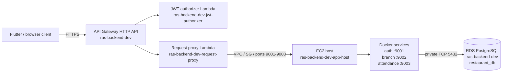
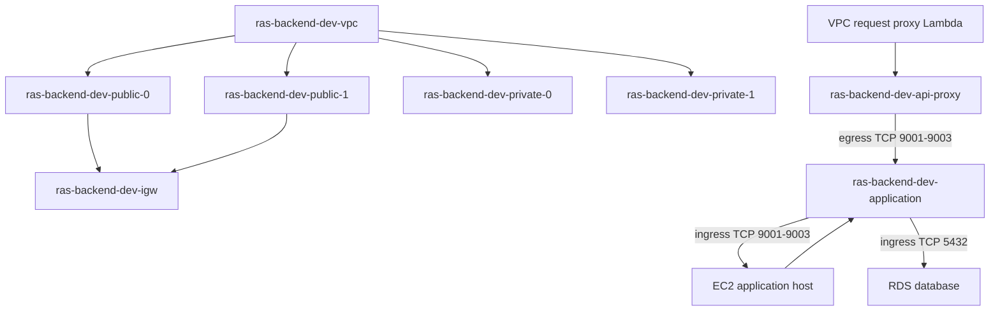
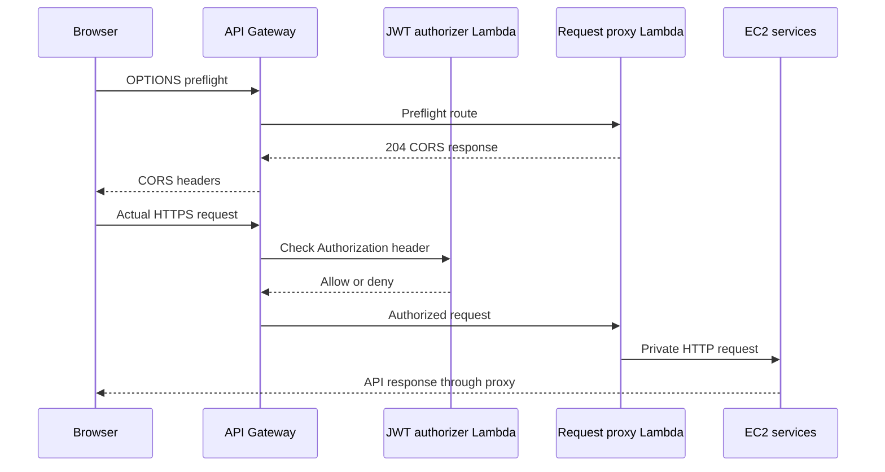
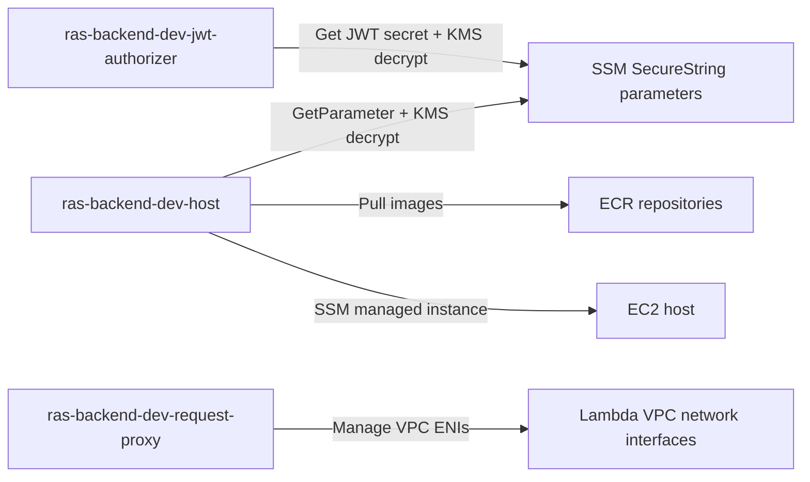
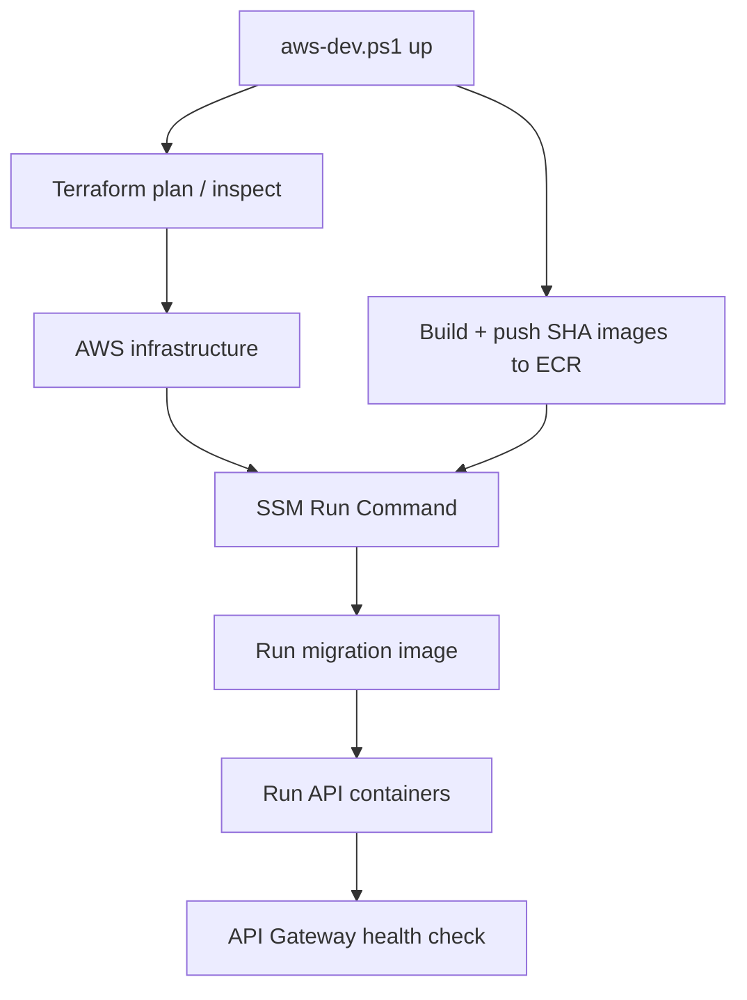

# RAS Backend AWS Resource Inventory

## Purpose

This document is a handoff for ChatGPT, platform engineers, and developers who
need to understand every AWS resource created by the RAS Backend Terraform
stack. It explains resource names, responsibilities, dependencies, network
paths, IAM relationships, and what survives EC2 replacement.

The development deployment uses AWS Region `eu-west-3` (Europe/Paris). Resource
IDs, endpoints, account numbers, passwords, JWT secrets, access tokens, and
Terraform state values are environment-specific and must not be copied into
documentation or chat.

## Architecture summary



## Terraform stack entry point

Terraform is run from:

```text
infra/terraform/dev
```

The root configuration composes:

```text
module.network
module.database
module.application
api-gateway.tf
```

The remote Terraform state bucket is created and managed separately:

```text
ras-backend-tfstate-<AWS_ACCOUNT_ID>-eu-west-3
```

The state bucket must remain available when the application stack is destroyed.
Terraform state contains sensitive infrastructure values and must be protected.

## 1. Network resources

| AWS resource | Console name | Purpose |
|---|---|---|
| VPC | `ras-backend-dev-vpc` | Private network boundary for EC2, Lambda ENIs, and RDS |
| Internet Gateway | `ras-backend-dev-igw` | Internet route for the public subnets |
| Public subnet 0 | `ras-backend-dev-public-0` | EC2 host subnet in the first availability zone |
| Public subnet 1 | `ras-backend-dev-public-1` | Additional public subnet |
| Private subnet 0 | `ras-backend-dev-private-0` | RDS/Lambda private networking |
| Private subnet 1 | `ras-backend-dev-private-1` | RDS/Lambda private networking |
| Public route table | `ras-backend-dev-public` | Routes public subnets to the internet gateway |
| Application security group | `ras-backend-dev-application` | Allows API proxy traffic to EC2 ports 9001-9003 |
| API proxy security group | `ras-backend-dev-api-proxy` | Controls VPC Lambda egress to EC2 |

### Network connections



The EC2 Instance Connect service CIDR for this deployment is:

```text
35.180.112.80/29
```

It is allowed on TCP port 22 for browser-based EC2 Instance Connect. Optional
direct SSH access is controlled by the `ssh_allowed_cidr` Terraform variable.

## 2. Database resources

| AWS resource | Console name | Purpose |
|---|---|---|
| RDS PostgreSQL instance | `ras-backend-dev` | Persistent PostgreSQL database |
| Database | `restaurant_db` | Application database inside RDS |
| RDS subnet group | `ras-backend-private-db` | Places RDS in private subnets |
| RDS security group | `ras-backend-postgres` | Allows PostgreSQL only from the application security group |
| Master password parameter | `/ras-backend/dev/database-master-password` | Encrypted SSM SecureString |

Database connection properties:

```text
Engine: PostgreSQL
Port: 5432
Master username: migration_admin
Database name: restaurant_db
Publicly accessible: false
```

The application services use separate PostgreSQL runtime roles:

```text
auth_app
branch_app
attendance_app
```

The EC2 database helper retrieves the encrypted master password through IAM and
connects to the private RDS endpoint:

```bash
/usr/local/bin/ras-db-shell.sh
```

Example read-only query:

```bash
/usr/local/bin/ras-db-shell.sh -c "SELECT COUNT(*) FROM users;"
```

RDS is protected by default with AWS deletion protection. The normal
`shell-down` operation removes only EC2. The complete `down` operation
explicitly disables database protection and permanently deletes development
data after confirmation.

## 3. EC2 application host

| AWS resource | Console name | Purpose |
|---|---|---|
| EC2 instance | Name tag `ras-backend-dev-app-host` | Runs Docker containers and provides the admin shell |
| IAM role | `ras-backend-dev-host` | EC2 permissions for SSM, ECR pulls, and encrypted SSM parameters |
| Instance profile | `ras-backend-dev-host` | Attaches the IAM role to EC2 |
| Root volume | Encrypted gp3, 8 GiB | Disposable host storage |
| SSH rule | EC2 Instance Connect CIDR | Browser-based administrative access |

The EC2 bootstrap installs:

- Docker;
- AWS CLI;
- PostgreSQL client;
- `jq`, `curl`, and `unzip`;
- Amazon SSM Agent;
- `/usr/local/bin/ras-backend-deploy.sh`;
- `/usr/local/bin/ras-db-shell.sh`;
- `/etc/ras-backend-deploy.env`.

The deployment environment file contains endpoint and parameter names, not
database passwords in plaintext. Password retrieval occurs through SSM at
command execution time.

## 4. ECR repositories

Terraform creates four immutable ECR repositories:

| Repository | Image purpose |
|---|---|
| `ras-auth-api` | Authentication and user-management service |
| `ras-branch-api` | Branch service |
| `ras-attendance-api` | Employee, attendance, and overtime service |
| `ras-db-migrations` | Goose migration runner image |

Each repository uses AES-256 encryption and immutable image tags. The deployment
script tags images with the full Git commit SHA, pushes them to ECR, and tells
the EC2 deployment helper which SHA to run.

## 5. Lambda functions

| Lambda function | IAM role | Purpose |
|---|---|---|
| `ras-backend-dev-jwt-authorizer` | `ras-backend-dev-jwt-authorizer` | Validates JWT access tokens for protected API routes |
| `ras-backend-dev-request-proxy` | `ras-backend-dev-request-proxy` | Forwards API Gateway requests into the private VPC |

### JWT authorizer

The authorizer:

1. Receives the `Authorization` header from API Gateway.
2. Reads the application secret parameter from SSM.
3. Validates the HS256 JWT.
4. Returns an allow/deny decision.

It does not query RDS and does not implement business operations.

### Request proxy

The request proxy:

1. Is attached to the private subnets.
2. Uses the API proxy security group.
3. Receives an authorized API Gateway request.
4. Forwards it to the EC2 private IP.
5. Selects the service port based on the request path.
6. Returns the service response to API Gateway.

The proxy Lambda requires IAM permissions to create, describe, assign, and
delete VPC network interfaces.

## 6. API Gateway resources

| AWS resource | Console name | Purpose |
|---|---|---|
| HTTP API | `ras-backend-dev` | Public HTTPS API entry point |
| Stage | `dev` | Deployment stage |
| Authorizer | `auth-hs256` | Connects protected routes to the JWT Lambda |
| Integration | Lambda proxy integration | Sends requests to the request proxy Lambda |

Public routes include:

```text
POST /api/v1/auth/login
POST /api/v1/auth/refresh
POST /api/v1/auth/logout
GET  /health
```

Protected routes include users, branches, employees, attendance, overtime, and
the remaining authentication operations. They use the custom JWT authorizer.

The API URL has this form:

```text
https://<API_ID>.execute-api.eu-west-3.amazonaws.com/dev
```

Retrieve the current URL without exposing secrets:

```powershell
terraform -chdir=infra/terraform/dev output -raw api_gateway_base_url
```

## 7. CORS resources and behavior

CORS is configured on the API Gateway HTTP API using the Terraform variable
`api_cors_allowed_origins`. It allows browser clients to call the API from
approved origins.

Configured methods:

```text
GET, POST, PUT, PATCH, DELETE, OPTIONS
```

Configured headers:

```text
authorization, content-type, x-request-id
```

The request proxy also handles `OPTIONS` preflight requests and returns
`Access-Control-Allow-*` response headers. CORS is not authentication; JWT
authorization and backend role checks remain required.



## 8. SSM and secrets

| Resource | Name | Used by |
|---|---|---|
| Application secrets | `/ras-backend/dev/application-secrets` | APIs and JWT authorizer |
| Database master password | `/ras-backend/dev/database-master-password` | EC2 deployment/database helper |
| EC2 managed policy | `AmazonSSMManagedInstanceCore` | SSM Agent and Run Command |

The application secrets parameter contains runtime credentials and must never
be printed. The database password parameter is a SecureString. IAM grants
`ssm:GetParameter` and constrained KMS decryption to the required roles.

## 9. IAM relationships



## 10. Deployment and teardown connections



Lifecycle behavior:

| Operation | Removes | Preserves |
|---|---|---|
| `up` | Nothing unexpectedly; refuses destructive changes | Existing RDS data |
| `shell-down` | EC2 application module and disposable host disk | RDS, ECR, API Gateway, network, state bucket |
| `down` | Complete application stack, including RDS data | Separately managed Terraform state bucket |

Commands:

```powershell
.\scripts\aws-dev.ps1 up
.\scripts\aws-dev.ps1 shell-down
.\scripts\aws-dev.ps1 down
```

## 11. Source-of-truth files

| Area | File |
|---|---|
| Terraform composition | [`infra/terraform/dev/main.tf`](../infra/terraform/dev/main.tf) |
| API Gateway and Lambda | [`infra/terraform/dev/api-gateway.tf`](../infra/terraform/dev/api-gateway.tf) |
| Network resources | [`infra/terraform/modules/network/main.tf`](../infra/terraform/modules/network/main.tf) |
| RDS resources | [`infra/terraform/modules/database/main.tf`](../infra/terraform/modules/database/main.tf) |
| EC2, IAM, ECR, bootstrap | [`infra/terraform/modules/application/main.tf`](../infra/terraform/modules/application/main.tf) |
| Lifecycle orchestration | [`scripts/aws-dev.ps1`](../scripts/aws-dev.ps1) |
| Local Docker topology | [`deploy/docker-compose.yml`](../deploy/docker-compose.yml) |
| Deployment usage | [`infra/terraform/dev/README.md`](../infra/terraform/dev/README.md) |

## 12. Rules for updating this inventory

When adding or changing AWS resources:

1. Add the Terraform resource name and the AWS console name.
2. Document its purpose and owning module.
3. Add inbound and outbound traffic relationships.
4. Add IAM permissions and the principal that uses them.
5. State whether the resource survives EC2 replacement or full teardown.
6. Label protocols, ports, routes, and trust boundaries.
7. Never document passwords, tokens, private keys, or secret values.
8. Verify diagrams against Terraform and deployed state before claiming that
   a resource exists.
